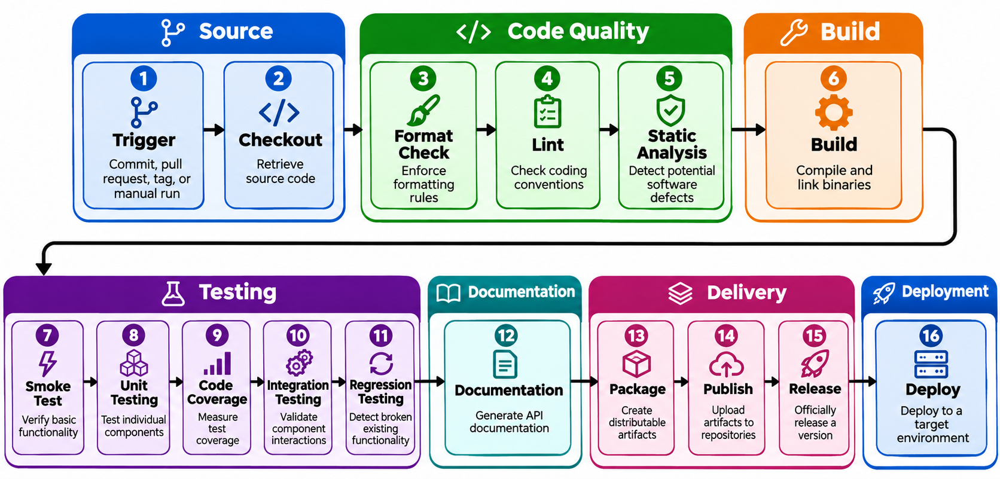
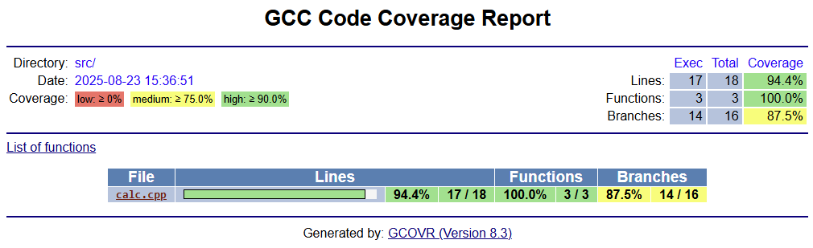

# Primes-CPP

Primes-CPP is a small C++ project designed to serve as a practical testbed for a complete CI pipeline. The codebase is intentionally simple: a minimal library with functions such as integer addition and prime number detection, a thin application entrypoint, and unit tests.

By keeping the application itself simple, the project emphasizes the end-to-end automation flow from checkout to publish, making it ideal for experimenting with toolchains, validating pipeline configurations, and serving as a template for larger C++ projects.

> For details on how this project is integrated into a full CI/CD workflow, refer to the [jenkins-pipeline](https://github.com/ManiAm/Jenkins-pipeline) project.

## Project Layout

The project is organized as follows:

    Project Root
    ├── src/                  # Core library source files
    │   ├── calc.h            # Header for calculator functions
    │   └── calc.cpp          # Implementation of calculator logic
    ├── app/                  # Application entry point(s)
    │   └── main.cpp          # Main program source
    ├── tests/                # Unit and integration tests
    │   └── test_calc.cpp     # Tests for calculator module
    ├── Makefile              # Build automation rules
    ├── .clang-format         # Code style configuration
    ├── conanfile.txt         # Conan package dependencies
    ├── Jenkinsfile           # CI pipeline definition
    ├── Dockerfile            # Container build definition
    └── docker-compose.yml    # Docker compose definition

### src/

This directory contains the source code and headers for the core library. For a small codebase, it is acceptable to keep headers alongside `.cpp` files. As the project grows, a common best practice is to split public headers into an `include/` directory while keeping implementation files in `src/`. This separation allows usage like `-Iinclude` and `#include <calc/calc.h>`, which cleanly distinguishes public APIs from internal code.

As a general guideline, headers should use `#pragma once` to prevent multiple inclusion, and compilation should enforce strict warning flags (e.g., `-Wall -Wextra`) to catch potential issues early.

### app/

This directory contains entrypoints and runnable binaries. The `main.cpp` file is kept intentionally thin: it parses arguments and delegates logic to functions implemented in `src/`. If additional tools or CLIs are added in the future, place them here (e.g., `prime_cli.cpp`) to keep the core library testable and decoupled from input/output concerns.

### tests/

This directory contains unit tests for validating the behavior of code in `src/`. The project uses the [Catch2](https://github.com/catchorg/Catch2) test framework, so `test_calc.cpp` both defines test cases and provides the test runner. Test runs generate JUnit XML reports, which CI systems can consume to visualize pass/fail status and track trends over time.

### Makefile

The Makefile defines one target per CI pipeline stage: format, lint, static, build, test, coverage, and package. This design ensures that the local developer workflow matches the pipeline exactly. The compiler can be switched easily (`CXX=clang++` or `CXX=g++`) without modifying the Makefile itself.

## CI Pipeline

A `Jenkinsfile` is a plain text file, written in Groovy-based syntax, that defines a Jenkins pipeline as code. It specifies the stages, steps, and environment required to build, test, and deploy an application. By treating the pipeline as code, teams gain consistency, collaboration, and traceability, since changes to the CI process are reviewed, versioned, and managed just like application code. Each branch, tag, or commit can carry its own pipeline definition, making the CI process fully reproducible and context-aware.

The following table shows the recommended logical sequence of pipeline stages, grouped by phase. This is not a mandatory CI/CD standard. Jenkins supports sequential stages, parallel stages, and conditional execution, so the exact flow can be adapted to fit project needs.

| Phase         | #  | Stage                | Purpose                                  |
|---------------|----|----------------------|------------------------------------------|
| Source        | 1  | Trigger              | Commit, pull request, tag, or manual run |
| Source        | 2  | Checkout             | Retrieve source code                     |
| Code Quality  | 3  | Format Check         | Enforce formatting rules                 |
| Code Quality  | 4  | Lint                 | Check coding conventions                 |
| Code Quality  | 5  | Static Analysis      | Detect potential software defects        |
| Build         | 6  | Build                | Compile and link binaries                |
| Testing       | 7  | Smoke Test           | Verify basic functionality               |
| Testing       | 8  | Unit Testing         | Test individual components               |
| Testing       | 9  | Code Coverage        | Measure test coverage                    |
| Testing       | 10 | Integration Testing  | Validate component interactions          |
| Testing       | 11 | Regression Testing   | Detect broken existing functionality     |
| Documentation | 12 | Documentation        | Generate API documentation               |
| Delivery      | 13 | Package              | Create distributable artifacts           |
| Delivery      | 14 | Publish              | Upload artifacts to repositories         |
| Delivery      | 15 | Release              | Officially release a version             |
| Deployment    | 16 | Deploy               | Deploy to a target environment           |

### Trigger

The trigger stage defines what initiates a pipeline run. Common triggers include a commit push, a pull request event, a tag creation, or a manual (parameterized) build. In Jenkins, triggers are configured through the `Jenkinsfile` using directives such as `triggers`, `when`, or webhook integrations.

Defining triggers explicitly makes the pipeline predictable: developers know exactly which events cause a build, and conditional logic can skip or include stages based on the trigger type. For example, a pull request might run only code quality and testing stages, while a tag push triggers the full pipeline through to release.

### Checkout

The checkout stage retrieves the project's source code from version control at the specific commit or branch associated with the build, ensuring that subsequent stages run against a consistent snapshot of the codebase. Depending on configuration, this may include checking out submodules, applying shallow clones to reduce network overhead, or verifying commit integrity for security.

### Code Formatting

Code formatting ensures that all source files follow a consistent, automated style. A formatter such as `clang-format` rewrites whitespace, indentation, line wrapping, and brace placement according to rules defined in a `.clang-format` file. Because formatting is deterministic and mechanical, style compliance should be non-negotiable across all branches and pull requests.

Developers can use `make format` to automatically reformat files locally, while pre-commit hooks help catch violations before they enter the repository. In continuous integration, `make format-check` enforces that the codebase never drifts from the agreed standard.

### Linting

Linting checks source code for style, convention, and maintainability issues without modifying files. Unlike a formatter, which only changes layout, a linter flags constructs that violate established policy, such as naming conventions, include ordering, modernization practices, and readability rules.

This project uses `cpplint`, a Python-based tool created by Google for enforcing the Google C++ Style Guide. It provides fast feedback on issues such as missing copyright headers, incorrect include order, or discouraged language features.

For teams looking to enforce deeper semantic rules, `clang-tidy` is a more advanced alternative. It integrates with the Clang compiler infrastructure and provides checks for readability, modern C++ usage, performance improvements, and bug-prone constructs. It can suggest replacing raw loops with range-based for loops, flag use of deprecated APIs, detect certain memory misuses, and automatically apply fixes for many issues. While `cpplint` is lightweight and style-focused, `clang-tidy` is better suited for larger or evolving codebases that benefit from modernization and deeper analysis.

### Static Code Analysis

Static analysis examines the semantics of a program without executing it. It goes beyond formatting and linting by focusing on program correctness: detecting uninitialized variables, null dereferences, memory leaks, portability problems, and potential performance pitfalls.

This project uses `cppcheck`, a compiler-independent static analyzer designed specifically for C/C++. It produces both human-readable diagnostics and machine-readable XML output, which can be integrated into CI pipelines for trend tracking and reporting.

In CI/CD, it is best practice to treat serious findings (e.g., undefined behavior, memory safety issues) as build-breaking, while allowing lower-severity findings to surface as warnings for incremental cleanup. Running static analysis early in the pipeline provides fast feedback and conserves build resources by catching problems before compilation or runtime tests.

For larger or safety-critical projects, commercial solutions such as `Coverity` (by Synopsys) are also widely used. Coverity provides deep, path-sensitive analysis that scales to millions of lines of code and integrates with enterprise CI/CD systems. It can detect complex defects such as concurrency issues, buffer overruns, resource leaks, and security vulnerabilities that might escape lightweight analyzers. It also offers dashboards, compliance tracking (e.g., MISRA, CERT), and management workflows, making it suitable for regulated industries where code quality and traceability are critical.

### Build

The build stage compiles the project deterministically with strict flags (e.g., `-Wall -Wextra`). The Makefile provides a clear entrypoint and supports switching compilers (`g++` vs. `clang++`). For projects requiring portability, a compiler or OS matrix can be introduced. Build caches like `ccache` help accelerate repeated builds.

The output binaries are placed in `build/bin/` and can be archived or passed to later stages (tests, packaging). Explicit dependency versions ensure that builds are reproducible and not affected by environment differences across machines.

### Smoke Test

A smoke test is a lightweight check performed immediately after a successful build to ensure that the compiled binary is minimally functional. It verifies that the application launches, runs without crashing, and produces expected basic output (for example, printing known console results or initializing key modules). The goal is not to validate correctness or cover all features, but simply to confirm that the build is healthy and stable enough to proceed with deeper testing. A failing smoke test typically signals a critical issue, such as a broken dependency, runtime crash, or mislinked library, that must be resolved before further tests are worthwhile.

> The term originates from hardware engineering. When technicians powered on a newly assembled circuit board for the first time, their simplest test was to see whether it emitted smoke. If it did, something was fundamentally broken and they stopped there. This pragmatic check carried over into software engineering as a metaphor for catching catastrophic failures early. Today, in CI/CD pipelines, smoke tests serve as the first line of defense: fast, lightweight checks that prevent wasting time and resources on builds that are already broken.

Note that a separate deployment smoke test can also be performed after the Deploy stage to verify that the application functions correctly in the target environment.

### Unit Testing

Unit testing verifies the smallest components of the codebase (functions, classes, or modules) in isolation. These tests ensure that individual units behave as expected given specific inputs. Unit tests should avoid external dependencies such as databases or networks, making them fast to execute and deterministic in results. They provide developers with immediate feedback during both local development and CI pipeline runs.

This project uses the [Catch2](https://github.com/catchorg/Catch2) framework for unit testing, with `make test` as the entry point. Test runs produce JUnit XML output, which CI systems can consume to visualize results, track historical trends, and highlight failures early in the development cycle.

### Code Coverage

Code coverage measures how much of the source code is exercised by tests. It is important to understand that coverage is a measurement, not a testing method. Tests must run against an instrumented build (compiled with flags like `--coverage`), and the resulting data shows which lines, branches, or functions were executed. Coverage can be collected from unit tests, integration tests, or both.

While coverage is not a direct measure of test quality, it is a valuable indicator of risk. Maintaining a high level of coverage ensures that critical paths are validated and reduces the likelihood of undetected regressions. Striving for 100% coverage is often impractical and unnecessary, but consistently tracking coverage helps identify blind spots.

This project generates coverage reports using `gcovr`. Reports should include both human-readable HTML and machine-readable formats (e.g., Cobertura XML) for automated enforcement. Coverage gates are best applied pragmatically: enforce no decrease relative to the main branch or set thresholds per change, rather than rigid global minimums that encourage low-value tests.

### Integration Testing

Integration testing validates that multiple components work correctly when combined. While unit tests prove correctness in isolation, integration tests catch issues that only appear when components interact, for example, a parser feeding data into a calculator or application code calling into a database. Integration tests may involve real or simulated dependencies and tend to run slower than unit tests, but they are critical for uncovering systemic issues.

A popular analogy highlights the difference: imagine a door secured by both a lock and a latch. A unit test checks that the latch closes correctly when tested in isolation, while an integration test verifies that the latch and the door handle together actually keep the door secure. This distinction illustrates why both levels of testing are needed for confidence in a system's overall behavior.

Integration tests normally run after unit tests. However, they can also be moved after the Package stage if the goal is to validate the actual installable artifact rather than the source tree.

### Regression Testing

Regression testing is the process of re-executing previously run test cases to ensure that recent code changes have not unintentionally broken existing functionality. Unlike unit or integration testing, which target specific levels of the software, regression testing is a strategy applied across all levels. Its primary goal is to confirm that the system continues to behave as expected after modifications. A regression suite can include unit tests, integration tests, and end-to-end tests.

In practice, regression testing involves maintaining a suite of automated tests that are rerun whenever the codebase changes. This ensures that new features integrate smoothly, bug fixes do not reappear, and overall system stability is preserved. Because it validates the unchanged parts of a system after updates, regression testing is essential in CI/CD pipelines where frequent changes must not compromise reliability. For larger projects, a dedicated regression stage allows extended test suites to run without slowing down the core testing phase.

### Documentation

Documentation is a critical component of any C++ project. Its purpose is to explain how the system is built, how to use it, and how others can extend or integrate with it. Clear documentation reduces onboarding time for new developers, helps users understand APIs and build procedures, and ensures long-term maintainability by preserving the reasoning behind design choices.

This project uses [Doxygen](https://www.doxygen.nl/) to generate documentation. Doxygen is the most widely used documentation system in the C++ ecosystem. It parses source files and extracts specially formatted comments to produce structured documentation in HTML, PDF, or man page formats. Doxygen can integrate with CMake and can automatically cross-link class hierarchies, namespaces, function signatures, and dependency graphs using Graphviz.

Documentation is generated before the Package stage so that generated docs can be included in the distributable artifact. If documentation is not part of the artifact, this stage can run in parallel with the testing stages to save pipeline time.

### Package

When builds and tests succeed, outputs are bundled into distributable artifacts. These may include compressed archives (e.g., tarballs, ZIPs), operating system packages (DEB/RPM), or container images.

Each artifact should be versioned using semantic versioning with optional commit metadata (e.g., `1.2.0+abc123`) to ensure traceability. To guarantee integrity, checksums (e.g., SHA-256) should be generated alongside the artifact. For supply chain security, additional metadata such as SBOMs (via tools like `syft`) and cryptographic signatures (via tools like `cosign`) can also be attached.

A well-packaged artifact is minimal, containing only the files and dependencies required by consumers, and should include concise metadata describing runtime requirements. The artifact should be built once and then promoted through subsequent delivery and deployment stages without being rebuilt, ensuring that the exact same validated binary is what reaches consumers.

### Publish

Publishing makes validated artifacts available to others by promoting them to their designated destinations. Targets may include package repositories (e.g., Artifactory, Nexus, PyPI, Maven Central), container registries (e.g., Docker Hub, ECR, GCR), or distribution platforms such as GitHub Releases.

Publishing credentials must follow the principle of least privilege and be rotated regularly. Published artifacts should be annotated with changelogs, version tags, and links back to the originating build for full traceability. To strengthen consumer trust, optional metadata such as SLSA provenance attestations, SBOMs, and digital signatures can be attached so downstream systems and users can verify authenticity and integrity before deployment.

### Release

A release marks the formal distribution of a software version to end users, distinguishing it from internal builds or unpublished artifacts. It is both a technical milestone and a product event, usually represented by a semantic version tag (e.g., `v1.2.0`) in source control. A release should be immutable, reproducible, and traceable to a specific commit and build pipeline.

A proper release includes release notes summarizing new features, bug fixes, and breaking changes, ideally auto-generated from commits or pull requests. Distribution is handled through established channels such as GitHub/GitLab Releases, customer portals, or internal delivery pipelines. In mature CI processes, releases are gated by quality controls (security scans, compliance checks, stakeholder approvals) and may trigger downstream workflows such as deployment or customer notifications.

The release stage typically runs conditionally, for example only on approved builds or tagged commits, rather than on every pull request.

In summary:

- **Package** → Create artifacts
- **Publish** → Push artifacts to repositories/registries
- **Release** → Tag and announce an official version for end users

### Deploy

The deploy stage delivers a released artifact to a target environment such as staging, production, or a customer-facing platform. For running services (e.g., web servers, microservices), deployment may be automated through continuous deployment or gated through continuous delivery with manual approval.

For libraries, SDKs, and downloadable software, a formal deploy stage may not be necessary since the Publish and Release stages already make the artifact available to consumers. When deployment does apply, it is important to distinguish between continuous delivery (artifact is always ready to deploy but requires manual approval) and continuous deployment (artifact is automatically deployed after passing all pipeline gates).

A post-deployment smoke test is recommended to verify that the application functions correctly in the target environment before routing user traffic.

## Ephemeral Docker Build Environment

The Jenkins pipeline is designed so that all build, test, and analysis stages run inside ephemeral Docker containers rather than directly on the Jenkins agent. At the start of the pipeline, Jenkins builds the project's Docker image (as defined in the Dockerfile) to encapsulate the full toolchain, dependencies, and runtime environment. Subsequent stages are executed inside disposable containers instantiated from this freshly built image.

This approach provides several advantages:

- **Clean Separation of Concerns**: The Jenkins agents only need Docker installed; they do not require any compilers, libraries, or runtimes. All build dependencies remain confined within the container image.

- **Consistency and Reproducibility**: Because the image is built from a version-controlled Dockerfile, every pipeline run uses the exact same environment. This eliminates discrepancies between developer machines and CI agents.

- **Polyglot Flexibility**: Different pipelines can provide different Dockerfiles, making it straightforward to support multiple languages or toolchains without cross-contamination.

- **Stateless Execution**: Containers are ephemeral. Once a stage completes, the container is discarded, leaving no residual state behind. Each run starts from a clean, deterministic environment, which improves the reliability of test results, static analysis, and coverage reports.

By adopting this model, the pipeline remains portable, maintainable, and free from dependency drift, while still enabling Jenkins to orchestrate the stages inside containerized environments.

## Getting Started

The steps below follow the same order as the CI pipeline stages described above.

### 1. Start the Build Environment

Start the container in background:

    docker compose up -d --build

Open an interactive shell to the container:

    docker exec -it primes-cpp bash

All subsequent commands are run inside the container.

### 2. Code Formatting

To check that all source files comply with the project's `.clang-format` style:

    make format-check

This command fails with an error if formatting is incorrect. It does not modify any files.

To automatically rewrite all source files to match the style rules:

    make format

### 3. Linting

To check for style and convention issues beyond formatting (e.g., include order, naming, header guards):

    make lint

This does not modify files, only prints warnings or errors.

### 4. Static Analysis

To run static code analysis using `cppcheck`:

    make static

The output is saved into the `cppcheck.xml` file.

### 5. Build

To compile the application:

    make -j build

### 6. Smoke Test

To run a quick sanity check after building:

    make smoke

This verifies that the binary runs correctly and produces the expected minimal output. The smoke test acts as a lightweight gate before running the full test suite.

### 7. Unit Testing

To run the unit tests:

    make -j test

The test results are stored in the `test-results` folder. To print the results to the console:

    make test-console

### 8. Code Coverage

To build with coverage instrumentation and generate a report:

    make coverage

Open the `coverage` folder to view the coverage HTML report.

### 9. Documentation

To generate API documentation using Doxygen:

    make docs

The generated HTML documentation is placed in `docs/doxygen/html/`.

### 10. Package

To bundle everything produced by the pipeline into a single distributable artifact:

    make package

This collects the application binary, test results (e.g., JUnit XML), and analysis reports (e.g., `cppcheck.xml`). These files are packaged into a versioned tarball (named with the project's Git tag or commit SHA) under the `dist/` directory, and a SHA-256 checksum file is generated for integrity verification.
